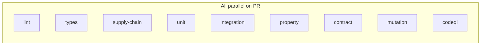

# Quality Toolchain Design

**Status:** Approved (brainstorming 2026-10-29)  
**Goal:** Add deterministic static analysis, extended test types (type, property, mutation, REST + GraphQL contracts), supply-chain scanning (pnpm audit + Trivy), and GitHub Actions CI with hard PR gates—plus optional non-blocking AI review—using a script-first layout that matches local and CI runs.

---

## Decisions summary

| Topic                            | Choice                                                                                  |
| -------------------------------- | --------------------------------------------------------------------------------------- |
| CI platform                      | GitHub Actions                                                                          |
| Orchestration                    | Script-first (`pnpm quality:*`) + parallel GHA jobs                                     |
| Merge policy                     | Hard gates on every PR                                                                  |
| Vulnerability scanning           | Trivy (filesystem) + `pnpm audit`; Dependabot for bumps                                 |
| AI-assisted quality              | Hybrid: deterministic CI required; AI review optional workflow                          |
| Contract tests                   | REST (supertest + JSON Schema) + GraphQL (SDL snapshot + operation smoke)               |
| Property / mutation / type on PR | All required; property = fixed small suite; mutation = Stryker on changed TS files only |
| Static analysis depth            | ESLint (existing) + `tsc --noEmit` + CodeQL (required)                                  |

---

## Current baseline

- **Lint:** ESLint 9 with `typescript-eslint`, `eslint-plugin-security`, `eslint-plugin-sonarjs`; Prettier via lint-staged.
- **Hooks:** Husky pre-commit (lint-staged + Gitleaks).
- **Tests:** Jest 30 — `pnpm test:unit`, `pnpm test:integration` (Testcontainers).
- **Supply chain:** Extensive `pnpm.overrides`; no audit/Trivy in CI.
- **CI:** None (`docs/features/features.md` lists CI/CD as missing).

---

## Architecture

### CI topology

**Triggers:** `pull_request` and push to `main`.  
**Concurrency:** Cancel in-progress runs for the same ref.  
**Runner:** `ubuntu-latest`, Node from `.nvmrc` (24.18.0).

**Required jobs** (branch protection must list these names):

| Job            | Script                      | Notes                                          |
| -------------- | --------------------------- | ---------------------------------------------- |
| `lint`         | `pnpm quality:lint`         | ESLint without `--fix`                         |
| `types`        | `pnpm quality:types`        | `tsc --noEmit` + `tsd`                         |
| `supply-chain` | `pnpm quality:supply-chain` | Frozen lockfile, audit, Trivy                  |
| `unit`         | `pnpm quality:unit`         | Existing unit tests                            |
| `integration`  | `pnpm quality:integration`  | Docker available for Testcontainers            |
| `property`     | `pnpm quality:property`     | Fixed fast-check suite                         |
| `contract`     | `pnpm quality:contract`     | REST + GraphQL                                 |
| `mutation`     | `pnpm quality:mutation`     | Stryker incremental; skip if no eligible files |
| `codeql`       | GitHub CodeQL workflow      | `javascript-typescript`, required on PR        |

**Optional workflow:** `.github/workflows/ai-review.yml` — `continue-on-error: true`; documents enabling Cursor Bugbot / CodeRabbit in repo settings; no API keys in the template.

**Job ordering:** Each job checks out, installs with frozen lockfile, caches pnpm, then runs its script. All required jobs are **siblings** (no `needs:` between test jobs) so wall-clock time stays low. Stryker runs unit tests internally; the standalone `unit` job still gates regressions on the full suite without waiting for Stryker.



### Script-first principle

Every required job invokes exactly one `pnpm quality:*` entry point. Shell helpers live under `scripts/ci/` with `set -euo pipefail`. GitHub workflows do not embed tool flags beyond calling scripts.

**Aggregate local command:**

- `pnpm quality` — runs all required scripts **sequentially** (documented as slow; use before opening a PR).
- Pre-push hook (recommended, not required for merge): `quality:lint`, `quality:types`, `quality:unit` only.

---

## Repository layout

| Path                                             | Purpose                                       |
| ------------------------------------------------ | --------------------------------------------- |
| `.github/workflows/quality.yml`                  | Parallel required jobs                        |
| `.github/workflows/codeql.yml`                   | CodeQL analysis                               |
| `.github/workflows/ai-review.yml`                | Optional AI / bot placeholder                 |
| `.github/dependabot.yml`                         | Weekly `pnpm` + GitHub Actions                |
| `scripts/ci/changed-ts-files.sh`                 | TS files changed vs PR base / `main`          |
| `scripts/ci/run-trivy.sh`                        | Trivy filesystem scan, fail HIGH/CRITICAL     |
| `scripts/ci/run-pnpm-audit.sh`                   | `pnpm audit` with same severity policy        |
| `test/type/`                                     | Type tests (`*.test-d.ts`) for `tsd`          |
| `test/property/`                                 | Property tests (`*.property.spec.ts`)         |
| `test/contracts/rest/`                           | REST contract tests                           |
| `test/contracts/graphql/`                        | GraphQL snapshot + operation tests            |
| `test/contracts/graphql/schema.snapshot.graphql` | Committed schema for diff                     |
| `jest.property.config.ts`                        | Jest config scoped to `test/property`         |
| `jest.contract.config.ts`                        | Jest config for contract suite                |
| `stryker.config.mjs`                             | Stryker + Jest runner; mutates `MUTATE_FILES` |
| `docs/quality/README.md`                         | Local commands, branch protection, AI opt-in  |

### `package.json` scripts (target)

```text
quality                 Full sequential parity with CI
quality:lint            eslint "{src,apps,libs}/**/*.ts" (no --fix)
quality:types           tsc --noEmit && tsd
quality:unit            test:unit
quality:integration     test:integration
quality:property        jest -c jest.property.config.ts
quality:contract        jest -c jest.contract.config.ts
quality:mutation        changed-ts-files → stryker or skip
quality:supply-chain    frozen lockfile + audit + trivy
quality:contract:update-snapshot   Regenerate GraphQL snapshot (maintainer)
```

---

## Tooling by concern

### Static analysis

- **ESLint:** Keep existing flat config; CI must not auto-fix.
- **Typecheck:** `tsc -p tsconfig.json --noEmit` (strict options already enabled).
- **CodeQL:** Standard GitHub template for JavaScript/TypeScript; required check on PRs.

### Type tests

- **Runner:** `tsd` with tests in `test/type/`.
- **Scope:** Public types exported from selected modules (e.g. core helpers, config parsers)—start with 1–2 files, expand over time.
- **Not in Jest:** Type tests are compile-time only; separate from runtime specs.

### Property-based tests

- **Library:** `fast-check` integrated with Jest.
- **Scope:** Fixed suite under `test/property/` targeting pure functions (e.g. overload/priority shed decisions, rate-limit math, adaptive limiter helpers)—not full Nest integration graphs.
- **CI:** Always runs full property suite (small, bounded runtime).

### Mutation tests

- **Runner:** Stryker with `@stryker-mutator/jest-runner`.
- **Scope:** Files from `scripts/ci/changed-ts-files.sh` under `src/`, excluding:
  - `*.spec.ts`, `*.integration.spec.ts`
  - `*.module.ts`, `main.ts`, `instrumentation.ts`
  - Generated `src/graphql.ts`
- **Empty scope:** Exit 0 with log message `mutation skipped: no eligible changed files`.
- **Artifacts:** Upload Stryker HTML report on failure in GHA.

### Contract tests

**REST**

- Bootstrapped Nest app (reuse patterns from existing HTTP specs; mock heavy dependencies where health specs already do).
- `supertest` against selected routes (minimum: readiness/liveness-style endpoints, standardized error envelope).
- Response bodies validated with **AJV** against committed JSON Schema fixtures in `test/contracts/rest/schemas/`.

**GraphQL**

- **Source of truth:** `**/*.graphql` (see `GraphQLModule` `typePaths` in `app.module.ts`); not generated `src/graphql.ts`.
- **Snapshot:** Committed `schema.snapshot.graphql`; CI fails on unintended SDL drift (`@graphql-inspector/cli` diff or equivalent).
- **Operations:** At least one query (and mutation if present in schema) executed against `/graphql` with expected shape/errors.

**Update path:** `pnpm quality:contract:update-snapshot` when schema changes are intentional; commit updated snapshot in the same PR.

### Supply chain

- **`pnpm install --frozen-lockfile`** in CI before any script.
- **`pnpm audit`:** Fail on high/critical (script wraps exit codes consistently with Trivy).
- **Trivy:** Filesystem scan of repository root including `pnpm-lock.yaml`; severity HIGH/CRITICAL fail the job.
- **Dependabot:** Weekly PRs for npm/pnpm and GitHub Actions; does not replace Trivy/audit gates.
- **Existing `pnpm.overrides`:** Retained; audit may still report until overrides cover new advisories—document remediation flow in `docs/quality/README.md`.

### Secrets

- **Pre-commit:** Gitleaks (unchanged).
- **Optional CI duplicate:** Gitleaks job in `quality.yml` for defense in depth (recommended, same hard gate).

### AI-assisted review (non-blocking)

- Workflow runs with `continue-on-error: true` or relies on external GitHub App (Bugbot, CodeRabbit).
- README documents enabling apps and that they do not replace deterministic gates.
- No LLM-generated test execution in required pipeline (avoids API keys, flakiness, and non-determinism in template).

---

## Local development

| Stage                     | Commands                                                                    |
| ------------------------- | --------------------------------------------------------------------------- |
| Every commit              | lint-staged + gitleaks (pre-commit)                                         |
| Pre-push (optional Husky) | `quality:lint`, `quality:types`, `quality:unit`                             |
| Before PR                 | `pnpm quality` or at minimum `quality:supply-chain` + `quality:integration` |
| Schema change             | `quality:contract:update-snapshot`                                          |

---

## Documentation and feature matrix

Update `docs/features/features.md`:

- **CI/CD pipeline:** Done — link to `docs/quality/README.md`
- **Dependency vulnerability scanning:** Done — audit + Trivy + Dependabot
- Add rows or notes for type tests, property tests, mutation tests (incremental), contract tests (REST + GraphQL), CodeQL

---

## Implementation rollout order

1. Add `pnpm quality:*` scripts and `scripts/ci/*` (lint, types, unit, supply-chain).
2. Add `.github/workflows/quality.yml` with parallel jobs and pnpm cache.
3. Introduce `test/type` + `tsd` with one exemplar test.
4. Introduce `test/property` + `fast-check` with one exemplar test.
5. Introduce `test/contracts` (REST then GraphQL snapshot + one operation).
6. Add Stryker config + `quality:mutation` incremental wiring.
7. Add CodeQL workflow + Dependabot config.
8. Add optional `ai-review.yml` and `docs/quality/README.md`; optional pre-push hook.
9. Optional: Gitleaks CI job.

---

## Error handling and operability

- All `scripts/ci/*.sh` use `set -euo pipefail`.
- CI logs clearly distinguish **skipped mutation** vs **failed mutation**.
- Failed mutation and contract jobs attach actionable artifacts (Stryker report, schema diff output).
- Integration and contract jobs use mocked Terminus/dependency indicators where existing specs already avoid flaking on external services.

---

## Out of scope

- Travis CI or other non-GitHub CI hosts.
- Pact broker or consumer-driven contract infrastructure (may be documented as a future extension).
- SonarCloud / Snyk paid dashboards as required gates.
- LLM-generated tests as merge blockers.
- WebSocket contract testing (REST + GraphQL only for v1).
- Full-repo mutation on every PR (incremental changed-files only).

---

## Success criteria

- A PR cannot merge unless all required jobs pass on GitHub Actions.
- A contributor can reproduce any single failing job with the matching `pnpm quality:*` command locally (except integration/mutation/Trivy where Docker or changed-file scope applies).
- Boilerplate documents branch protection settings and optional AI bots without embedding secrets.
